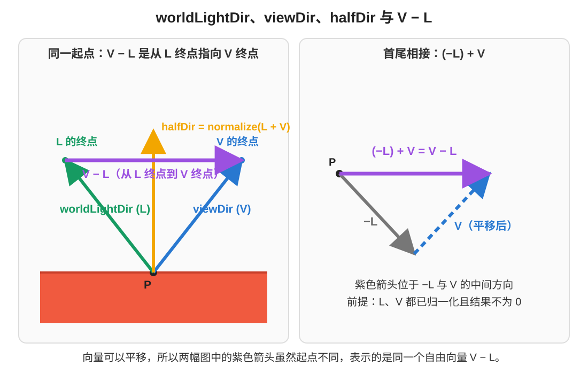

# Chapter 9：前向渲染学习笔记

相关文件：

- [Chapter9-ForwardRendering.shader](../Assets/Shaders/Chapter9/Chapter9-ForwardRendering.shader)
- 

## 

## 1. 本章使用的方向约定

设当前正在着色的表面点为 `P`：

| 名称 | Shader 变量 | 方向 |
| --- | --- | --- |
| 光源方向 | `L` / `worldLightDir` | 表面点 `P` → 光源 |
| 光线传播方向 | `-L` / `-worldLightDir` | 光源 → 表面点 `P` |
| 观察方向 | `V` / `viewDir` | 表面点 `P` → 相机 |
| 半程向量 | `H` / `halfDir` | 当 `L`、`V` 为单位向量且 `L + V != 0` 时，`H = normalize(L + V)`，为二者的内角平分方向 |
| 世界空间法线 | `N` / `worldNormal` | 从表面向外 |

必须注意：不同书籍可能用 `I` 表示不同方向。有的资料把 `I` 定义为光线的传播方向，有的资料把它定义为表面指向光源的方向。因此不能只看字母，必须先确认向量的起点和终点。

在本文约定中，如果 `I` 表示“表面点指向灯泡”，那么：

```text
I = L = worldLightDir
-I = -L = 光线传播方向
```

## 2. 漫反射为什么使用 `worldLightDir`

Lambert 漫反射计算为：

```hlsl
float NdotL = max(0, dot(N, L));
```

这里的 `L` 必须从表面指向光源，而不是光线从光源射向表面的传播方向。

当表面朝向光源时，`N` 与 `L` 的夹角小于 90°，点积为正。如果错误地使用 `-L`，点积会变成负数，朝向光源的表面反而得不到漫反射光照。

当前 Shader 的主要代码是：

```hlsl
Light mainLight = GetMainLight();
half3 worldLightDir = normalize(mainLight.direction);

half3 diffuse = mainLight.color
              * _Diffuse.rgb
              * max(0, dot(i.worldNormal, worldLightDir));
```

在 URP 中，这里的 `mainLight.direction` 已经表示世界空间中从当前表面指向光源的方向，因此对应 `L`。

## 3. `viewDir` 与 `halfDir`

观察方向的计算为：

```hlsl
half3 viewDir = normalize(_WorldSpaceCameraPos.xyz - i.worldPos);
```

两个位置相减时：

```text
终点 - 起点 = 从起点指向终点的向量
```

所以：

```text
相机位置 - 表面位置 = 表面点 P → 相机
```

Blinn-Phong 使用的半程向量为：

```hlsl
half3 halfDir = normalize(worldLightDir + viewDir);
```

即：

```text
H = normalize(L + V)
```

当 `L`、`V` 都是单位向量且结果不为零时，`H` 是它们的角平分方向。

镜面高光计算为：

```hlsl
half3 specular = mainLight.color
               * _Specular.rgb
               * pow(max(0, dot(i.worldNormal, halfDir)), _Gloss);
```

## 4. 如何理解向量加法 `L + V`

向量只表示方向和长度，可以在不改变方向、长度的情况下平移。向量加法可以理解为连续执行两个移动指令。

假设：

```text
P --L--> A
```

然后把 `V` 平移到 `A`，从 `A` 继续移动：

```text
P --L--> A --V--> C
```

那么整个移动的结果是：

```text
P --------L+V--------> C
```

因此，`L + V` 是从最初的共同起点 `P` 指向平行四边形对角点 `C` 的向量。

如果反过来从 `C` 指向 `P`，得到的不是 `L + V`，而是：

```text
-(L + V)
```

这里的“移动”只是理解向量运算的几何方法，并不表示光子真的沿 `L` 传播。实际光线传播方向是 `-L`。

## 5. 如何理解 `-L + V` 和 `V - L`

代数上：

```text
-L + V = (-L) + V = V - L
```

### 5.1 首尾相接的画法

从某个起点先执行 `-L`，再把 `V` 平移到 `-L` 的终点继续执行。最终从初始点指向最终点的结果，就是 `V - L`。

### 5.2 两个向量共用起点的画法

设 `L` 和 `V` 都从 `P` 出发：

```text
A = P + L    // L 的终点
B = P + V    // V 的终点
```

从 `A` 指向 `B` 的向量为：

```text
B - A
= (P + V) - (P + L)
= V - L
```

所以，当 `L`、`V` 共用起点时：

```text
V - L：从 L 的终点指向 V 的终点
L - V：从 V 的终点指向 L 的终点
```

“首尾相接得到的结果向量”和“从 `L` 终点指向 `V` 终点的向量”可能画在不同位置，但向量允许平移，所以它们表示同一个自由向量。

当 `L`、`V` 都已归一化且 `-L + V` 不为零向量时，`normalize(-L + V)` 位于 `-L` 与 `V` 的中间方向。它不是 Blinn-Phong 使用的 `halfDir`。

还可以验证：

```text
(V + L) · (V - L)
= V·V - L·L
= 1 - 1
= 0
```

因此，当 `L`、`V` 都是单位向量时，`L + V` 与 `V - L` 互相垂直；前提是相关结果不是零向量。

## 6. 为什么使用 `CBUFFER_START(UnityPerMaterial)`

当前 Shader 中：

```hlsl
CBUFFER_START(UnityPerMaterial)
    half4 _Diffuse;
    half4 _Specular;
    float _Gloss;
CBUFFER_END
```

它把这个材质使用的 HLSL 参数集中声明在名为 `UnityPerMaterial` 的 GPU 常量缓冲区中。

可以把它理解为一个材质参数包：

```text
UnityPerMaterial
├── _Diffuse
├── _Specular
└── _Gloss
```

这样组织的主要目的是让自定义 URP Shader 兼容 SRP Batcher。所有能够进入常量缓冲区的材质参数，例如标量、向量、颜色和矩阵，应放在同一个名为 `UnityPerMaterial` 的常量缓冲区中；纹理和采样器在 CBUFFER 外单独声明。多 Pass Shader 的各个 Pass 要保持相同的缓冲区布局。

不使用这个写法时，Shader 可能仍然可以编译并正确显示，但可能失去 SRP Batcher 兼容性，增加 CPU 准备和切换材质数据的开销。

Unity 官方参考：

- [SRP Batcher](https://docs.unity3d.com/Manual/SRPBatcher.html)
- [为 URP 编写带颜色输入的 Unlit Shader](https://docs.unity3d.com/cn/Packages/com.unity.render-pipelines.universal%4012.1/manual/writing-shaders-urp-unlit-color.html)

### `Properties` 与 `CBUFFER` 的区别

`Properties` 块负责：

- 在材质 Inspector 中显示属性。
- 保存材质设置。
- 提供默认值。

`UnityPerMaterial` 常量缓冲区负责：

- 在 HLSL 中声明相应变量。
- 声明这些材质参数在 GPU 常量缓冲区中的布局；实际上传与绑定由 Unity 完成。
- 满足 SRP Batcher 对材质参数布局的要求。

因此，同一个材质属性通常需要同时出现在 `Properties` 和 HLSL 声明中。

`CBUFFER_START` / `CBUFFER_END` 是 Unity 提供的跨图形 API 宏，可以近似理解为：

```hlsl
cbuffer UnityPerMaterial
{
    // 材质变量
};
```

## 7. 当前结论速查

```text
worldLightDir = L = 表面 → 光源
-worldLightDir = -L = 光源 → 表面
viewDir = V = 表面 → 相机
halfDir = normalize(L + V)
漫反射使用 dot(N, L)
V - L = 从 L 的终点指向 V 的终点
L + V = 从共同起点指向平行四边形对角点
UnityPerMaterial CBUFFER = 传给 GPU 的材质参数包，并用于兼容 SRP Batcher
```

## 8. 后续问题

后续与 Chapter 9 前向渲染相关的问题继续追加在这里。内容明显属于其他章节时，再在 `Docs` 目录中新建对应章节文件并更新索引。
