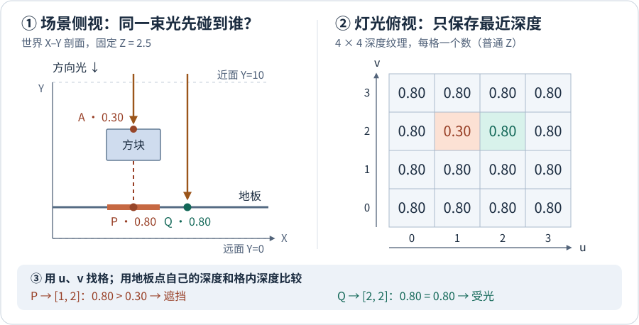

# Chapter 9：URP 阴影 Shader 问答

相关文件：

- [Chapter 9 前向渲染学习笔记](Chapter09-ForwardRendering.md)
- [Chapter9-Shadow.shader](../Assets/Shaders/Chapter9/Chapter9-Shadow.shader)

本文对应项目版本：Unity `2022.3.62f3`、URP `14.0.12`。

本文默认已经理解对象空间、世界空间、齐次裁剪空间，以及基本的 Lambert 和 Blinn-Phong 前向光照，重点解释阴影数据如何进入光照计算，以及为什么同一个 Shader 需要两个 Pass。

## 1. 先建立整体认识：阴影不是在一次绘制中完成的

实时阴影至少包含两个阶段：

```text
阶段 A：从灯光视角绘制
网格 -> ShadowCaster Pass -> 阴影贴图（主要记录离灯最近的深度）

阶段 B：从相机视角绘制
网格 -> UniversalForward Pass
     -> 计算当前表面点的阴影坐标
     -> 查询阴影贴图，得到 shadowAttenuation
     -> 计算并输出屏幕颜色
```

所以这个 Shader 中的两个 Pass 不是二选一：

- `ShadowCaster` 负责提供“谁挡住了光”的数据。
- `UniversalForward` 负责使用这些数据，决定当前表面点的直接光要被压暗多少。

同一盏灯的阴影贴图会汇总所有参与该次阴影绘制的投影物体，并不是某个物体只给自己使用。一个物体的 `ShadowCaster` 可以让另一个物体的 `UniversalForward` 查询到它造成的遮挡。

最终颜色可以先概括成：

```hlsl
最终颜色 = 环境光
         + (漫反射 + 镜面高光)
         * 距离衰减
         * 阴影衰减;
```

阴影通常只削弱直接光，不削弱环境光或其他间接光。否则一个点进入阴影后会连环境照明也消失，结果往往黑得不自然。

### 1.1 把灯光当成一台只拍深度的相机

想象一个方块悬在地板上，方向光竖直向下。对方向光来说，光线互相平行，所以可以用**正交投影**：从灯光视角看，方块顶面 A 和它正下方的地板点 P 会投影到同一个二维位置，但 A 比 P 更靠近灯光。旁边的地板点 Q 投影到另一个位置，光能直接照到它。



这张图的左边是沿世界 Z 轴看的侧视剖面；右边是从灯光方向看下去的二维纹理。**阴影贴图的二维位置来自灯光的视角，和游戏相机画面上的像素位置没有直接对应关系。**

### 1.2 第一次绘制：3D 三角形怎样变成一张二维深度图

配套实验：[沿着一条光线 · Three.js 交互演示](Chapter09-Shadow-Mapping-3D.html)。按「下一步」依次换轴、投影、写图和查图。顶部记录 A 的中间结果，点击 `q`、灯光坐标、NDC 或 `(u, v, z)` 可以回到对应的推导。

从页首进入「坐标转换实验」，可以拖动灰色世界原点 `W` 的三根把手。实验把 `W` 的偏移应用到世界坐标的读法。沿世界 X 把 `W` 移 1 格，默认标记的世界 X 从 `2.6` 变成 `1.6`，灯光坐标仍为 `(1, 2, −3)`。因此「灯光到世界」矩阵的第四列用 `O − W`，它表示灯光原点相对当前世界原点的位置。

按「下一步」可以逐列试算灯光到世界的矩阵，再用灯光坐标在 3D 里放标记。最后读取标记或地板点 B 的世界位置，借 `V_light` 换成灯光坐标，经投影得到阴影图的行列与深度。高亮格展示实际选中的纹素，深度表用该纹素的存储值判断阴影。

1. **确定灯光视角。** 方向光本身只需要方向；渲染阴影图还需要选一个灯光坐标原点、三根轴和一个有限的覆盖盒。`V_light` 用原点和轴把世界位置换成灯光坐标，`P_light` 再用覆盖盒的边界把灯光坐标映射到裁剪空间。[下面从这些输入构造矩阵，并代入实际数字](#light-matrix-walkthrough)。
2. **把投影物体的网格画到深度纹理上。** `ShadowCaster` 先把模型顶点变到世界空间，应用阴影 Bias，再用 `P_light × V_light` 变到裁剪空间。GPU 裁剪并做齐次除法（`xyz / w`；本例正交投影的 `w = 1`），再把平面坐标映射到深度纹理的视口。光栅化时，GPU 判断投影后的三角形覆盖了哪些纹素采样位置，并为这些位置算出投影深度。这样，三维位置的前两个投影分量决定「写哪格」，深度分量决定「用什么数去做深度测试」。一个三角形可以覆盖许多格。
3. **每格只留下最近的一层。** 每个参与投影的片元都和该格已有的深度做深度测试，测试通过才更新。以图中的普通 Z 为例，`[1,2]` 先清成远端值 `1.00`，地板若先画进去会写 `0.80`，方块顶面再以 `0.30` 覆盖它。若先画方块，地板就通不过测试，结果仍是 `0.30`。没有投影片元覆盖的格保留清除值。

为什么 `TransformWorldToHClip` 在这里是从灯光看？[URP 的 `RenderShadowSlice`](../Library/PackageCache/com.unity.render-pipelines.universal@14.0.12/Runtime/ShadowUtils.cs#L198) 在 `DrawShadows` 之前执行 `cmd.SetViewProjectionMatrices(view, proj)`，把当前绘制使用的视图、投影矩阵切到灯光视角。于是 [本章 `ShadowCaster` 顶点函数](../Assets/Shaders/Chapter9/Chapter9-Shadow.shader#L176) 里的同一个函数用的就是灯光矩阵：

```hlsl
float3 biasedWorldPos = ApplyShadowBias(worldPos, worldNormal, _LightDirection);
o.pos = TransformWorldToHClip(biasedWorldPos);
```

**实际数据结构：** 主光的 `_MainLightShadowmapTexture` 是一张 GPU 上的 `W × H` **二维深度渲染纹理**。可以把它想成 `depth[row][column]`：每个纹素逻辑上只有一个经过量化的投影深度。图里的 `0.30` 不是 RGB、阴影浓度、物体 ID 或世界坐标，也不是「灯到 A 的 0.30 米」。[主光 Pass](../Library/PackageCache/com.unity.render-pipelines.universal@14.0.12/Runtime/Passes/MainLightShadowCasterPass.cs#L27) 请求 16 位深度；[`ShadowUtils`](../Library/PackageCache/com.unity.render-pipelines.universal@14.0.12/Runtime/ShadowUtils.cs#L443) 通过 Unity 选择深度格式，颜色格式为 `None`。调试器把它显示成灰度图，只是为了让人看见深度数值。

<a id="light-matrix-walkthrough"></a>

#### V 和 P 从哪来？把数字代进去算一遍

**实际运行时：Unity 引擎计算，URP 拿来用。** [主光阴影 Pass](../Library/PackageCache/com.unity.render-pipelines.universal@14.0.12/Runtime/Passes/MainLightShadowCasterPass.cs#L140) 为每个级联请求一对矩阵。它从当前相机的剔除结果 `cullResults` 出发，传入主光索引、级联编号和分割设置、阴影图分辨率以及灯光的 Shadow Near Plane。这里的相机决定**哪一片场景需要覆盖**，方向光决定**沿什么方向看**。[本项目 URP 14.0.12 的调用](../Library/PackageCache/com.unity.render-pipelines.universal@14.0.12/Runtime/ShadowUtils.cs#L110) 如下：

```csharp
bool success = cullResults.ComputeDirectionalShadowMatricesAndCullingPrimitives(
    shadowLightIndex, cascadeIndex, shadowData.mainLightShadowCascadesCount,
    shadowData.mainLightShadowCascadesSplit, shadowResolution, shadowNearPlane,
    out shadowSliceData.viewMatrix, out shadowSliceData.projectionMatrix,
    out shadowSliceData.splitData);
```

[这个 Unity API](https://docs.unity3d.com/cn/6000.0/ScriptReference/Rendering.CullingResults.ComputeDirectionalShadowMatricesAndCullingPrimitives.html) 直接返回 `viewMatrix`（V）和 `projectionMatrix`（P）。本项目的 URP C# 源码能确认输入、输出和使用位置；引擎怎样拟合覆盖盒，不在这段 C# 里。如果想看当前场景某一帧的真实数值，可在[调用结束之后](../Library/PackageCache/com.unity.render-pipelines.universal@14.0.12/Runtime/ShadowUtils.cs#L116)打断点，在调用成功时查看这两个字段以及当前的 `cascadeIndex`。

**下面换成可手算的数值。** 这里用 [Three.js 演示中的参数](Chapter09-Shadow-Mapping-3D.html)，不是对 Unity 当前帧矩阵的抄录。这个例子是斜着照的，阴影图宽 4 格、高 6 格；§1.4 的静态图是竖直照的另一组例子。先使用普通 Z，忽略 Bias、级联偏移和过滤。

可以按问题跳转到[右轴为什么读到 1](#right-axis-reading)、[垂线为什么一定垂直](#right-axis-projection-foot)、[矩阵第一行怎样先代 O 再代 A](#view-first-row)。

**第一步：选灯光的三根轴和原点，构造 V。**

**先选两件事，再算出一组轴。** 这组数是教学示例选的起点，并不是从当前 Unity 场景里量出来的。先选光线往哪儿走，再选画面的哪边朝上。光线方向只决定镜头朝哪儿；沿着镜头朝向转动相机，朝向不变，但画面的上方和右方会一起转。所以光线方向本身还不能决定 U 和 R。

1. **选光线方向，再算后轴 K。** 用世界轴写出「右 3、下 4」的箭头 `(3, -4, 0)`，它长 `√(3² + 4²) = 5`。各分量除以 5，得到单位方向 `F = (0.6, -0.8, 0)`。灯光坐标约定正 Z 指向后方，所以取反得到 `K = -F = (-0.6, 0.8, 0)`。
2. **选一个与光线垂直的上轴 U。** 示例的光线完全在世界 XY 平面里，所以可以选世界 `-Z` 作上方：`U = (0, 0, -1)`。验证：`U · K = 0 × (-0.6) + 0 × 0.8 + (-1) × 0 = 0`。这一步是示例的选择，换一个绕光线转过的上方也可以。
3. **按右手坐标系算右轴 R。** 右手坐标系要求「上 × 后 = 右」，所以算 `U × K`。叉积的结果与 U、K 都垂直；这里两个输入都长 1，且互相垂直，结果也长 1：

$$
\begin{aligned}
R &= U \times K,\qquad
R_x = 0\times0-(-1)\times0.8 = 0.8 \\
R_y &= (-1)\times(-0.6)-0\times0 = 0.6,\qquad
R_z = 0\times0.8-0\times(-0.6) = 0 \\
R &= (0.8,0.6,0)
\end{aligned}
$$

到这里，**R、U、K 都还是用世界轴写的方向向量**。比如 R 的意思是「沿世界 X 走 0.8，沿世界 Y 走 0.6」，并不是某个点在灯光坐标中的位置。接下来用这三根新轴去量 A，才会得到 A 的灯光坐标。

| 符号 | 在这个例子里怎么选 | 用世界轴 `X、Y、Z` 表示 |
| --- | --- | --- |
| `F`：光线向前 | 选「向世界右走 3、向下走 4」的方向，除以长度 5 | `(0.6, -0.8, 0)` |
| `K`：灯光的后轴 | 用 `-F`，所以灯光坐标里往前走，`zₗ` 会变小 | `(-0.6, 0.8, 0)` |
| `U`：灯光的上轴 | 选世界 `-Z`，它和光线垂直 | `(0, 0, -1)` |
| `R`：灯光的右轴 | 取 `U × K`，得到同时垂直于上轴和后轴的单位向量 | `(0.8, 0.6, 0)` |
| `O`：灯光坐标原点 | 在演示里直接设定，作为量位置的起点 | `(0, 5.8, 4)` |

`O` 是灯光视图用来量位置的参考点。方向光的光线彼此平行，光线方向只决定朝向。HTML 固定 `O = (0, 5.8, 4)`，用 `fromLight(1, 2, 3)` 构造 **默认** 点 `A = O + 1R + 2U + 3F = (2.6, 4, 2)`。若手算时从同一个世界点 `A` 出发，也可以用等价的式子 `O = A − R − 2U − 3F` 反算原点。

取方块顶面 `A = (2.6, 4, 2)`，先算 `q = A - O = (2.6, -1.8, -2)`。箭头现在从 O 指向 A，**这三个数依然用世界轴表示**。按灯光轴表示这段位移时，要找出 `q = xₗR + yₗU + zₗK` 中的三个系数。这个例子最终得到 `(1, 2, −3)`，也就是 `q = 1R + 2U − 3K`，从 O 按这三段走会回到 A。[为什么点积能读出系数](Graphics-Fundamentals.md#view-space-coordinates)

$$
\begin{aligned}
x_\ell &= q\cdot R = 2.6\times0.8 - 1.8\times0.6 - 2\times0 = 1 \\
y_\ell &= q\cdot U = 2.6\times0 - 1.8\times0 - 2\times(-1) = 2 \\
z_\ell &= q\cdot K = 2.6\times(-0.6) - 1.8\times0.8 - 2\times0 = -3
\end{aligned}
$$

<a id="right-axis-reading"></a>
##### 为什么右轴投影恰好是 1？

`fromLight(1, 2, 3)` 先用灯光坐标来摆放 A。第一个参数给 A 预设了沿 R 的距离 `1`，另外两段分别沿 U、F 走。U 和 F 都垂直于 R，所以这两段对右轴读数的贡献是零。R 的长度是 `1`，因此第一段的读数原样保留。

$$
(xR + yU + dF)\cdot R
= x\underbrace{(R\cdot R)}_{1}
  +y\underbrace{(U\cdot R)}_{0}
  +d\underbrace{(F\cdot R)}_{0}
= x
$$

把 `fromLight` 的第一个参数改成 `0.4` 或 `2`，就会分别读回 `0.4` 或 `2`。灯光横坐标 `xₗ` 量的是带符号的长度。直到后面的投影和纹理映射，才用 `0～1` 的比例 `u` 表示覆盖盒内的位置。

在「V · 换轴」的「读右轴 xₗ」小步，用「移动 A 的世界 X」可以横移方块和顶面点 A。把世界 X 从 `2.6` 改成 `1.85`，`V_light` 的输出从 `(1, 2, −3)` 变成 `(0.4, 2, −2.55)`。`R` 和 `K` 都有世界 X 分量，所以 `xₗ` 和 `zₗ` 都随之改变。`U` 沿世界 −Z，所以 `yₗ` 仍是 `2`。后续投影和纹理坐标使用移动后的 A。

写图会用移动后的方块重新求交。比如将世界 X 调到 `4.6`，A 落进第 1 行、第 3 列，A 自身深度为 `0.42`。该格记录中心射线打到的方块顶面深度 `0.45`，因为移动后的 A 偏离纹素中心。让 B 留在第 2 列时，原来的 `0.80 > 0.30` 变成 `0.80 = 0.80`，因此 B 受光。

<a id="right-axis-projection-foot"></a>
##### 为什么 HA 必定垂直于 R，斜看时却不像直角？

先把 H 当作红轴上的待定点，再用直角条件求 H 的位置。所以每次更换 A 后重新求 H，虚线仍垂直于轴，垂足却可能落在不同刻度。[垂足公式的推导和斜看直角的原理](Graphics-Fundamentals.md#axis-projection-right-angle)

本例中，H 在红轴上离 O 一格。用世界坐标算一次，可以直接核对直角。

$$
\begin{aligned}
H &= O + 1R = (0.8,6.4,4) \\
\overrightarrow{HA} &= A-H = (1.8,-2.4,-2) \\
\overrightarrow{HA}\cdot R &= 1.8\times0.8 - 2.4\times0.6 - 2\times0 = 0
\end{aligned}
$$

<a id="view-first-row"></a>
##### 矩阵第一行是什么，为什么要先代 O 再代 A？

灯光坐标系由原点 `O` 和三根轴 `R、U、K` 定义。`V_light` 把世界坐标换成灯光坐标，把对 `q = A − O` 的三次点积一次算完。点击[交互演示](Chapter09-Shadow-Mapping-3D.html)顶部的「V_light · 灯光坐标」，可以从投影刻度开始，逐步换零点、写出各行并代入点验算。

**先看待定的第一行。** 它的前三格是 R 的三个世界分量，第四格暂记为 `c`。右边乘的是一个点的世界坐标，点的第四项补 `1`。第一行的输出是这个点的灯光横坐标 `xₗ`。

$$
\begin{bmatrix}0.8 & 0.6 & 0 & c\end{bmatrix}
\begin{bmatrix}x\\y\\z\\1\end{bmatrix}
= 0.8x + 0.6y + 0z + c\times1
$$

**第一次代入，用 O 解出第四格 `c`。** 给右边的输入列填 `(0, 5.8, 4, 1)`。这是灯光原点，所以要求输出 `0`。`O` 是字母，第一项里的 `0.8 × 0` 来自它的世界 X 分量。

$$
\begin{aligned}
\underbrace{0.8\times0 + 0.6\times5.8 + 0\times4}_{R\cdot O} + c &= 0 \\
c &= -R\cdot O = -3.48
\end{aligned}
$$

**第二次代入，用已确定的第一行换算 A。** 左边第四格已经填好 `−R · O`，右边改填待转换点的 `(A_x, A_y, A_z, 1)`。

$$
\begin{aligned}
x_\ell
&= \underbrace{0.8A_x + 0.6A_y + 0A_z}_{R\cdot A}
   + \underbrace{(-R\cdot O)\times1}_{c\times1} \\
&= R\cdot A - R\cdot O
\end{aligned}
$$

**最后的 `R · (A − O)` 是同一结果的等价写法。** 用分配律把同方向的两项合并。例如世界 Y 项为 $0.6A_y-0.6O_y=0.6(A_y-O_y)$，X 和 Z 同理。

$$
R\cdot A-R\cdot O
= 0.8(A_x-O_x)+0.6(A_y-O_y)+0(A_z-O_z)
= R\cdot(A-O)
$$

这一行算的是从 O 沿红轴量到 A 的垂足的带符号距离。在同一条过世界原点 W、沿 R 的数轴上，A 的投影刻度是 `4.48`，O 的投影刻度是 `3.48`。从后一处开始量，就得到 `4.48 − 3.48 = 1`。

第二、三行沿 U、K 做同样的计算，所以第四格分别是 `4` 和 `−4.64`。第四行保留点输入的 `w = 1`。用默认点验算，得到灯光坐标 `(1, 2, −3)`。后轴读数 `−3` 表示沿光线向前 `3` 个单位。

$$
\underbrace{\begin{bmatrix}
0.8 & 0.6 & 0 & -3.48 \\
0 & 0 & -1 & 4 \\
-0.6 & 0.8 & 0 & -4.64 \\
0 & 0 & 0 & 1
\end{bmatrix}}_{V_{\mathrm{light}}}
\begin{bmatrix}2.6\\4\\2\\1\end{bmatrix}
=
\begin{bmatrix}1\\2\\-3\\1\end{bmatrix}
$$

还可以输入原点 `(0, 5.8, 4, 1)`，验证整张矩阵输出 `(0, 0, 0, 1)`。同一矩阵也能从「灯光 → 世界」取逆得到，对应三根轴从列转成行的推导见[图形学基础](Graphics-Fundamentals.md#view-matrix-construction)。

**第二步：选灯光覆盖盒的六条边界，构造 P。**

演示选择一个能容纳 A 和地板点 B 的盒子：灯光横向 `xₗ ∈ [-4, 4]`、纵向 `yₗ ∈ [0, 8]`、向前的距离 `d ∈ [0, 10]`。正交投影对每一根轴分别换刻度：从旧区间左端走了多少，除以旧区间长度，得到比例；再把这个比例放到从 `-1` 开始、总长为 `2` 的新尺上。

| 轴 | 由覆盖范围得到的公式 | 代入 A 的灯光坐标 |
| --- | --- | --- |
| 横向 | `-1 + 2 × (xₗ + 4) / 8 = 0.25 × xₗ` | `-1 + 2 × 5 / 8 = 0.25` |
| 纵向 | `-1 + 2 × yₗ / 8 = 0.25 × yₗ - 1` | `-1 + 2 × 2 / 8 = -0.5` |
| 深度 | `-1 + 2 × d / 10 = -0.2 × zₗ - 1` | `-1 + 2 × 3 / 10 = -0.4` |

把这三条公式的乘数和常数填进矩阵，拿**上一步的输出**做输入：

$$
\underbrace{\begin{bmatrix}
0.25 & 0 & 0 & 0 \\
0 & 0.25 & 0 & -1 \\
0 & 0 & -0.2 & -1 \\
0 & 0 & 0 & 1
\end{bmatrix}}_{P_{\mathrm{light}}}
\begin{bmatrix}1\\2\\-3\\1\end{bmatrix}
=
\begin{bmatrix}0.25\\-0.5\\-0.4\\1\end{bmatrix}
$$

乘完 P 得到裁剪坐标。本例是正交投影，第四项 `w = 1`，所以除以 w 后，前三项原样成为 NDC（归一化设备坐标）。横向和纵向两行都没有用 `zₗ`，因此同一条光线上的点即使前后距离不同，横、纵读数仍相同。

**第三步：把 A 和地板 B 都走一遍。** 纹理坐标以 0 到 1 记比例，三个 NDC 分量各做 `0.5 × 数值 + 0.5`。例如 A 的横向 `0.25` 变成 `u = 0.625`，深度 `-0.4` 变成 `z = 0.30`。

| 点 | 世界位置 | 乘 V 后：灯光坐标 | 再乘 P 并除以 w：NDC | 换到纹理刻度 `(u, v, z)` |
| --- | --- | --- | --- | --- |
| 方块 A | `(2.6, 4, 2)` | `(1, 2, -3)` | `(0.25, -0.5, -0.4)` | `(0.625, 0.25, 0.30)` |
| 地板 B | `(5.6, 0, 2)` | `(1, 2, -8)` | `(0.25, -0.5, 0.6)` | `(0.625, 0.25, 0.80)` |

两点的 `u、v` 相同：从 0 开始数，列是 `floor(0.625 × 4) = 2`，行是 `floor(0.25 × 6) = 1`。写图时同一格留下 A 的 `0.30`；读图时用 B 自己的 `0.80` 去比较，发现它在 A 后面。这也就是 `P_light × V_light × 世界位置` 要从右往左读的原因：**V 先产出灯光坐标，P 才能按灯光覆盖盒的范围换刻度。**

### 1.3 第二次绘制：当前表面点怎样得到 `(u, v, z)`

游戏相机绘制地板时，相机投影决定三角形覆盖哪些屏幕像素。前向顶点函数把每个顶点的**世界位置**写进 `o.worldPos`；GPU 在相机画面里光栅化三角形时，对这些世界位置做透视校正插值，因此 `frag` 收到的 `i.worldPos` 就是当前片元对应的表面位置。接着 Shader 用**灯光的投影**查这个点是否被挡住。

```hlsl
// Chapter9-Shadow.shader：前向 Pass 的 vert 中
o.worldPos = positionInputs.positionWS;

// 同一 Pass 的 frag 中
float4 shadowCoord = TransformWorldToShadowCoord(i.worldPos);
Light mainLight = GetMainLight(shadowCoord);
```

在普通或级联方向光阴影路径中，`TransformWorldToShadowCoord` 把世界位置乘以 `_MainLightWorldToShadow[cascadeIndex]`，返回 `(u, v, z, 0)`。这个矩阵使用**写图时同一份灯光视图和投影**，还包含纹理坐标所需的缩放和偏移（以及相应的深度方向处理）。写图时，GPU 把投影位置映射到视口内的纹素；读图时，矩阵把投影位置映射到同一区域的归一化 UV。**`u、v` 指向第一次写入的纹素位置；`z` 是当前表面点的参考深度，与纹理中保存的深度使用同一套编码。** 返回向量里的第四个分量 `0` 只是占位，并非第 1.2 节的齐次 `w`；这条方向光路径不再做齐次除法。

### 1.4 手算：同是地板，为什么 P 在阴影里而 Q 不在？

沿用图里的 **4×4 正交深度图**。设光从世界 `+Y` 向下照，横向覆盖世界 `X、Z` 的 `[0, 4]`，近面在 `Y = 10`，远面在 `Y = 0`。取 `+X` 和 `+Z` 为纹理 `u、v` 的正方向。假设方块和铺满视口的地板都参与投影，所以除了方块挡住的格，其他格存的都是地板深度。为便于手算，先用普通 Z（近 `0`、远 `1`），忽略 Bias 和过滤：

```text
世界点 (x, y, z_world) → (u, v, d) = (x / 4, z_world / 4, (10 - y) / 10)
单格采样（本例 UV 在 [0,1) 内）：列 i = floor(u × 4)，行 j = floor(v × 4)
```

图表用 `[列, 行]` 标记纹素，对应 `depth[行][列]`。

| 表面点 | 世界位置 `(x, y, z_world)` | 投影结果 `(u, v, d)` | 纹素 `[列, 行]` | 深度贴图中的值 |
| --- | --- | --- | --- | --- |
| 方块顶面 A | `(1.5, 7, 2.5)` | `(0.375, 0.625, 0.30)` | `[1, 2]` | `0.30`，来自 A |
| 地板 P | `(1.5, 2, 2.5)` | `(0.375, 0.625, 0.80)` | `[1, 2]` | `0.30`，来自 A |
| 地板 Q | `(2.5, 2, 2.5)` | `(0.625, 0.625, 0.80)` | `[2, 2]` | `0.80`，来自地板 |

- **P：`0.80 > 0.30`。** 灯光沿同一个位置向下照，先遇到方块，后才到 P；P 被遮挡。
- **Q：`0.80 == 0.80`。** 灯光在这条线上先遇到的就是 Q 所在的地板；Q 受光。

这里的 `floor` 只用来说明单格查表。实际 URP 在 [`SampleShadowmap`](../Library/PackageCache/com.unity.render-pipelines.universal@14.0.12/ShaderLibrary/Shadows.hlsl#L269) 使用比较采样器。以 [D3D11 宏实现](../Library/PackageCache/com.unity.render-pipelines.core@14.0.12/ShaderLibrary/API/D3D11.hlsl#L136) 为例，`SAMPLE_TEXTURE2D_SHADOW` 展开后的关键调用是：

```hlsl
textureName.SampleCmpLevelZero(samplerName, (coord3).xy, (coord3).z)
```

`xy` 指定采样位置，`z` 交给采样器比较。返回的是**受光程度**，不是贴图中的 `0.30`：单次比较通过是 `1`，不通过是 `0`；带过滤时可以混合相邻位置的比较结果。灯的 Shadow Strength 再决定把遮挡结果乘进直接光之前削弱多少。比如强度只有 `0.75`，完全遮挡处的最终 `shadowAttenuation` 是 `0.25`。

**反向 Z：** 若平台用反向 Z（近 `1`、远 `0`），例中的 `0.30` 和 `0.80` 分别变成 `0.70` 和 `0.20`。P 此时是 `0.20 < 0.70`，仍然更远、仍被挡住。实际 URP 会匹配写入和比较所用的深度方向，所以不要把手算里的 `>` 原样硬编码进去。

### 1.5 开了级联或屏幕空间阴影，还这样查吗？

- **级联阴影（Cascades）：** 近处和远处使用不同的灯光覆盖范围。URP 把各级深度图画进同一张二维大图（atlas）的不同小块；查询时，`ComputeCascadeIndex(positionWS)` 根据世界位置与各级包围球的关系选出级联，再用对应矩阵。该矩阵已经包含小块在 atlas 中的缩放与偏移，所以 `shadowCoord.xy` 指向整张大图中的位置。`z` 仍和该级写入的深度比较。
- **屏幕空间阴影：** 启用对应 Renderer Feature 时，不透明物体的前向 Pass 用相机的屏幕 UV 查 `_ScreenSpaceShadowmapTexture`，那里存的是预先算好的阴影衰减。灯光的深度图仍要先生成，深度比较只是提前到了屏幕空间阴影 Pass。两张纹理存的值不同。

**在 Unity 里观察：** 打开本章不透明物体的阴影场景，先保持一盏开实时阴影的方向光。为了和手算一致，可以用一个级联、关闭 Screen Space Shadows 和软阴影。打开 `Window > Analysis > Frame Debugger` 并启用，展开 `MainLightShadow` 看灯光视角的深度目标，再到 `DrawOpaqueObjects` 选地板的绘制，查看它绑定的主光阴影纹理。想验证因果，可以关掉方块的 Cast Shadows，重新捕获这一帧，观察方块不再写入深度目标、地板上对应阴影消失。参见 [Unity 的 Frame Debugger 对照截图](https://docs.unity3d.com/Packages/com.unity.render-pipelines.universal@14.0/manual/renderer-feature-screen-space-shadows.html)。

## 2. Shader 最外层代码在组织什么

### 2.1 `Properties`

```shaderlab
Properties
{
    _Diffuse ("Diffuse", Color) = (1, 1, 1, 1)
    _Specular ("Specular", Color) = (1, 1, 1, 1)
    _Gloss ("Gloss", Range(8.0, 256)) = 20
    [Toggle(_AdditionalLights)]
    _AddLights ("AddLights", Float) = 1
}
```

`Properties` 负责让材质保存这些属性，并把它们显示在 Inspector 中。

`[Toggle(_AdditionalLights)]` 除了显示勾选框，还会让材质在勾选时启用关键字 `_AdditionalLights`。这个关键字随后控制附加光循环是否编译进当前材质所用的 Shader 变体。

必须特别注意大小写：

```text
_AdditionalLights   当前 Shader 自己定义的材质开关
_ADDITIONAL_LIGHTS  URP 管线定义和选择的关键字
```

HLSL 预处理关键字区分大小写，它们不是同一个关键字。

### 2.2 `SubShader` 标签

```shaderlab
Tags
{
    "RenderPipeline" = "UniversalPipeline"
    "RenderType" = "Opaque"
}
```

- `RenderPipeline = UniversalPipeline`：只让 URP 使用这个 `SubShader`。
- `RenderType = Opaque`：把它归类为不透明物体。当前 Shader 没有真正的透明度裁剪代码，因此这个分类是合理的。

### 2.3 为什么使用 `HLSLINCLUDE`

`HLSLINCLUDE ... ENDHLSL` 中的声明会被下面两个 Pass 共同看到。当前文件借此共享：

- URP 的核心与光照函数。
- `UnityPerMaterial` 材质常量缓冲区。
- `a2v` 和 `v2f` 结构体。

它的作用是共享代码，并不代表两个 Pass 会合并成一次绘制。

### 2.4 `a2v` 与 `v2f`

```hlsl
struct a2v
{
    float4 vertex : POSITION;
    float3 normal : NORMAL;
    float4 tangent : TANGENT;
};

struct v2f
{
    float4 pos : SV_POSITION;
    float3 worldNormal : TEXCOORD0;
    float3 worldPos : TEXCOORD1;
};
```

- `a2v` 是网格送入顶点着色器的数据，位置、法线、切线都从对象空间开始。
- `v2f` 是顶点着色器送往光栅化器和片元着色器的数据。
- `SV_POSITION` 告诉 GPU：`pos` 是光栅化所需的齐次裁剪空间位置。
- `TEXCOORD0/1` 在这里不是说数据一定是纹理坐标；它们只是用于传递自定义插值数据的通道。

## 3. `UniversalForward` Pass 在做什么

### 3.1 `LightMode = UniversalForward`

```shaderlab
Tags { "LightMode" = "UniversalForward" }
```

URP 从相机视角进行前向渲染时，会查找带有这个 `LightMode` 的 Pass。这个 Pass 的片元着色器最终返回屏幕颜色。

### 3.2 问题 1：这么多 `multi_compile` 都要用到吗？

先说结论：不是所有自定义 Shader 都必须照抄这些行。每一组关键字都应该对应一个确实要支持的运行时分支；支持的功能越多，变体越多。

当前前向 Pass 的关键字是：

```hlsl
#pragma shader_feature _AdditionalLights
#pragma multi_compile _ _MAIN_LIGHT_SHADOWS _MAIN_LIGHT_SHADOWS_CASCADE _MAIN_LIGHT_SHADOWS_SCREEN
#pragma multi_compile _ _SHADOWS_SOFT
```

#### `multi_compile` 到底做了什么

它不是“运行到这一行时打开功能”，而是让 Unity 预先把同一段 Shader 编译成多个版本。例如：

```hlsl
#pragma multi_compile _ _SHADOWS_SOFT
```

会产生两个候选版本：

1. `_SHADOWS_SOFT` 没有定义，走硬阴影相关代码。
2. `_SHADOWS_SOFT` 已定义，走软阴影相关代码。

其中 `_` 表示“这一选项不定义任何关键字”。运行时 URP 再根据管线设置选择合适的版本。

多行的选项数量会相乘。当前前向 Pass 在剥离无用变体之前，单看这三组就是：

```text
2 × 4 × 2 = 16 个组合
```

这里的第一个 `2` 来自 `shader_feature _AdditionalLights`。它与 `multi_compile` 都会产生变体；主要差别是构建时 Unity 可以根据材质使用情况剥离未使用的 `shader_feature` 变体，而 `multi_compile` 用于管线或运行时可能动态选择的组合。

#### 每一行是否需要

| 关键字组 | 作用 | 当前 Shader 是否需要 |
| --- | --- | --- |
| `_MAIN_LIGHT_SHADOWS`、`_MAIN_LIGHT_SHADOWS_CASCADE`、`_MAIN_LIGHT_SHADOWS_SCREEN` | 支持主光无阴影、普通阴影、级联阴影和屏幕空间阴影 | 要接收主光阴影就需要相应选项。放在同一行表示互斥，比拆成多行清楚 |
| `_SHADOWS_SOFT` | 让阴影采样支持软阴影 | URP 资产可能在硬/软阴影间切换时需要；只做硬阴影的固定练习可以去掉 |
| `_AdditionalLights` | 当前 Shader 自定义的材质开关 | 希望每个材质单独决定是否执行附加光循环时保留，否则可以重新设计 |

原文件还声明过：

```hlsl
#pragma multi_compile _ _ADDITIONAL_LIGHTS_VERTEX _ADDITIONAL_LIGHTS
```

但当前附加光循环只读取小驼峰材质关键字 `_AdditionalLights`，没有读取这两个大写 URP 关键字，也没有实现逐顶点分支，所以这组 pragma 只会增加无效组合。目标 Shader 中已经删除；若以后要真正跟随 URP 的逐顶点/逐像素设置，应先实现对应代码路径，再恢复这组变体。

URP 14.0.12 的 `TransformWorldToShadowCoord` 会在 `_MAIN_LIGHT_SHADOWS_SCREEN` 分支内根据世界位置自行计算标准化屏幕坐标，所以当前写法可以保留屏幕空间阴影变体，不需要由 `v2f` 额外传一份屏幕坐标。

如果练习目标只剩“方向光主阴影”，完整兼容 URP 主光阴影模式的关键字组就是：

```hlsl
#pragma multi_compile _ _MAIN_LIGHT_SHADOWS _MAIN_LIGHT_SHADOWS_CASCADE _MAIN_LIGHT_SHADOWS_SCREEN
```

项目明确不使用 Screen Space Shadows 时，可以删掉 `_MAIN_LIGHT_SHADOWS_SCREEN`；再明确关闭级联阴影时，才能继续缩成 `_ _MAIN_LIGHT_SHADOWS`。是否保留 `_SHADOWS_SOFT` 则取决于是否允许软阴影。

原代码还把级联关键字写成了：

```text
_MAIN_LIGHT_SHADOWS_CACADE
```

正确拼写是：

```text
_MAIN_LIGHT_SHADOWS_CASCADE
```

关键字必须完全匹配 URP 源码中的名字，拼错后 URP 的级联阴影代码不会进入对应分支。目标 Shader 中已经修正。

### 3.3 顶点着色器为什么这样写

```hlsl
VertexPositionInputs positionInputs = GetVertexPositionInputs(v.vertex.xyz);
o.pos = positionInputs.positionCS;
o.worldPos = positionInputs.positionWS;

VertexNormalInputs normalInputs = GetVertexNormalInputs(v.normal, v.tangent);
o.worldNormal = NormalizeNormalPerVertex(normalInputs.normalWS);
```

这里一次准备了片元阶段需要的三类数据：

- `positionCS`：GPU 光栅化三角形必须使用。
- `positionWS`：计算观察方向、查附加光、计算阴影坐标时使用。
- `normalWS`：计算 `N·L` 和 `N·H` 时使用。

顶点之间的法线会被插值，插值结果长度可能不再严格等于 `1`，所以片元着色器中又调用了 `NormalizeNormalPerPixel`。顶点阶段归一化不能替代片元阶段归一化。

### 3.4 阴影坐标是什么

```hlsl
float4 shadowCoord = TransformWorldToShadowCoord(i.worldPos);
```

直接查深度图时，`shadowCoord.xy` 是主光阴影纹理的采样地址，`shadowCoord.z` 是当前片元在同一灯光投影下的参考深度。`TransformWorldToShadowCoord` 只生成坐标；`GetMainLight(shadowCoord)` 才用它做比较。两次绘制为什么能对上、屏幕空间变体有什么不同，见第 1 节的图和手算过程。

### 3.5 问题 2：`GetMainLight(shadowCoord)` 与不传参数有什么区别？

URP 14.0.12 的 `Light` 结构体包含：

```hlsl
struct Light
{
    half3 direction;
    half3 color;
    float distanceAttenuation;
    half shadowAttenuation;
    uint layerMask;
};
```

两个重载的核心逻辑可以简化成：

```hlsl
Light GetMainLight()
{
    Light light;
    light.direction = ...;
    light.color = ...;
    light.distanceAttenuation = ...;
    light.shadowAttenuation = 1.0;
    return light;
}

Light GetMainLight(float4 shadowCoord)
{
    Light light = GetMainLight();
    light.shadowAttenuation = MainLightRealtimeShadow(shadowCoord);
    return light;
}
```

所以差别非常集中：

| 调用 | 方向、颜色、距离衰减 | `shadowAttenuation` |
| --- | --- | --- |
| `GetMainLight()` | 有 | 初始化为 `1`，即不考虑实时阴影 |
| `GetMainLight(shadowCoord)` | 同样有 | 根据该阴影坐标查询主光阴影 |

带阴影参数的版本不是“只返回阴影”，而是先得到完整的主光数据，再额外填好阴影衰减。因此它当然仍然可以提供 `direction` 和 `color` 来计算漫反射与镜面高光。

当前光照关系是：

```hlsl
half3 diffuse = mainLight.color * _Diffuse.rgb * max(0, dot(N, L));
half3 specular = mainLight.color * _Specular.rgb * pow(max(0, dot(N, H)), _Gloss);

half attenuation = mainLight.distanceAttenuation
                 * mainLight.shadowAttenuation;

half3 color = ambient + (diffuse + specular) * attenuation;
```

字段的分工是：

- `direction`、`color` 决定直接光的方向和颜色。
- `distanceAttenuation` 决定距离、聚光范围或剔除造成的衰减。主光通常是方向光，因此一般不是普通意义上的距离平方衰减。
- `shadowAttenuation` 决定遮挡造成的衰减：`1` 表示完全受光，`0` 表示完全被挡住，软阴影边缘可以是中间值。
- `ambient` 来自球谐环境光数据，不是 `mainLight` 的字段，也不应因为改用有阴影的重载而消失。

原代码虽然调用了 `GetMainLight(shadowCoord)`，却只把 `distanceAttenuation` 乘进颜色，等于查询了阴影但没有使用查询结果。目标 Shader 中已经改为同时乘上 `mainLight.shadowAttenuation`。

#### 它等价于 Built-in 管线的 `TRANSFER_SHADOW` 吗？

不等价。旧的 Built-in 管线通常分成两步：

```text
TRANSFER_SHADOW(o)       生成并传递阴影坐标
SHADOW_ATTENUATION(i)    用阴影坐标采样，得到阴影值
```

当前 URP 写法也是两步，只是 API 不同：

```text
TransformWorldToShadowCoord(positionWS)  生成阴影坐标
GetMainLight(shadowCoord)                返回完整主光，并填好阴影衰减
```

### 3.6 附加光循环目前支持到什么程度

```hlsl
Light light = GetAdditionalLight(index, i.worldPos);
```

这个两参数重载提供附加光方向、颜色和距离/聚光衰减，但在 URP 14 源码中把 `shadowAttenuation` 保持为 `1`。当前代码也只乘了 `light.distanceAttenuation`，因此目前计算的是“无实时阴影的附加光”。

当前项目三个 URP Renderer Asset 都使用普通 Forward 模式，这个 `GetAdditionalLightsCount()` 加普通 `for` 循环可以工作；它不兼容 Forward+。URP 14 在 Forward+ 下让 `GetAdditionalLightsCount()` 返回 `0`，需要改用 URP 的集群灯光遍历宏，并增加 `_FORWARD_PLUS` 变体。

若以后要让点光源、聚光灯也产生并被接收实时阴影，还需要同时补齐：

- `_ADDITIONAL_LIGHT_SHADOWS` 变体。
- 能查询阴影的 `GetAdditionalLight` 重载或相应阴影函数。
- `light.shadowAttenuation` 对直接光的乘法。
- 支持点光/聚光的标准 `ShadowCaster` 顶点路径。

这部分不属于当前最小修改，所以只在代码注释和本文中标明限制，没有顺手扩展功能。

## 4. 问题 3：`SV_TARGET` 还是 `SV_Target`？

建议统一写：

```hlsl
SV_Target
```

它是片元着色器输出颜色的系统值语义；`SV_Target0` 与 `SV_Target` 等价，`SV_Target1` 等用于多渲染目标。

在当前 Unity/URP 环境中，`SV_TARGET` 也能工作，URP 14 自己的 `ShadowCasterPass.hlsl` 就使用了全大写写法；Unity 手册和 Microsoft 的语义表则通常写成 `SV_Target`。因此这里主要是统一风格，不是两种不同功能。目标 Shader 已统一为 `SV_Target`。

不要把这件事类推到 Shader 关键字：`_AdditionalLights` 与 `_ADDITIONAL_LIGHTS` 是预处理标识符，大小写不同就确实是两个名字。

## 5. `ShadowCaster` Pass 在做什么

### 5.1 渲染状态

```shaderlab
Cull Off
ZWrite On
ZTest LEqual
```

- `Cull Off`：正反面都投射阴影，适合纸片、围栏、树叶卡片等薄片模型。封闭模型通常也可以使用默认的 `Cull Back`。
- `ZWrite On`：把离灯最近的深度写进阴影贴图。
- `ZTest LEqual`：只有更靠近灯光的片元才能更新当前深度。

### 5.2 问题 4：`#pragma shader_feature _ALPHATEST_ON` 是什么意思？

它声明两个材质变体：

```text
变体 A：未定义 _ALPHATEST_ON
变体 B：定义了 _ALPHATEST_ON
```

名字 `_ALPHATEST_ON` 只是约定俗成的关键字。真正让低透明度像素消失的是 Shader 中的裁剪代码，例如：

```hlsl
#if defined(_ALPHATEST_ON)
    half alpha = SAMPLE_TEXTURE2D(_BaseMap, sampler_BaseMap, i.uv).a;
    clip(alpha - _Cutoff);
#endif
```

`clip(x)` 在 `x < 0` 时丢弃当前片元。把相同裁剪放进 `ShadowCaster` Pass 后，栅栏或叶片纹理中的透明洞才不会投下整块矩形阴影。

当前 Shader 没有 `_BaseMap`、UV、`_Cutoff`，片元函数里也没有 `clip()`，因此：

```text
#pragma shader_feature _ALPHATEST_ON
```

目前只会声明变体，不会产生任何可见效果。对于当前纯不透明 Shader 可以删除；如果后续要学习镂空阴影，则应保留并补齐采样与裁剪代码。

当前 `Properties` 中也没有驱动 `_ALPHATEST_ON` 的开关。后续实现时，可以增加类似 `[Toggle(_ALPHATEST_ON)]` 的材质属性，或者由材质代码启用该关键字；但无论如何，仍然必须配合实际的 `clip()` 分支。若打包后才由脚本动态启用，还要确保相应 `shader_feature` 变体没有被构建剥离。

### 5.3 问题 5：`_LightDirection` 从哪里来，做什么？

```hlsl
float3 _LightDirection;
```

它不是材质属性，所以不需要写在 `Properties` 中。URP 在绘制阴影贴图之前，会从 C# 侧把它设置为全局 Shader 变量。

在 URP 14.0.12 中，调用链可以在包源码中核对：

```text
ShadowUtils.SetupShadowCasterConstantBuffer(...)
    -> 根据正在投影的灯光计算 lightDirection
    -> CommandBuffer.SetGlobalVector(_LightDirection, ...)
    -> 执行物体的 ShadowCaster Pass
```

对方向光来说，每个顶点到光源的方向相同，所以一个全局 `_LightDirection` 就够了。这里的方向遵循前向渲染笔记中的约定：

```text
_LightDirection = L = 表面 -> 光源
```

它在当前 Pass 中不用于计算颜色，而是传给 `ApplyShadowBias`，帮助决定顶点应该向哪里做阴影偏移。

点光源和聚光灯不同：表面上不同位置指向灯的位置方向不同。URP 的标准 `ShadowCasterPass.hlsl` 会额外接收 `_LightPosition`，按顶点计算：

```hlsl
normalize(_LightPosition - positionWS)
```

当前教学 Shader 只有 `_LightDirection` 路径，因此它主要覆盖方向光投影；不能因为 Pass 名叫 `ShadowCaster` 就认为点光、聚光的标准路径也已经自动完成。

### 5.4 问题 6：`ApplyShadowBias` 是什么意思？

```hlsl
float3 biasedWorldPos = ApplyShadowBias(worldPos, worldNormal, _LightDirection);
```

阴影贴图精度有限。一个表面既写入阴影贴图，又在相机绘制时拿自己的深度与阴影贴图比较，微小的量化和插值误差可能让它误以为“前面还有遮挡物”，出现条纹或黑点，这叫 shadow acne（阴影痤疮/自阴影伪影）。

`ApplyShadowBias` 在写入阴影贴图之前稍微移动投影位置，让深度比较留出容错空间。URP 14 的核心实现可简化为：

```hlsl
float invNdotL = 1.0 - saturate(dot(lightDirection, normalWS));
float normalScale = invNdotL * _ShadowBias.y;

positionWS += lightDirection * _ShadowBias.x;
positionWS += normalWS * normalScale;
```

两部分分别是：

- 深度偏移：沿光线相关方向移动，由 `_ShadowBias.x` 控制。
- 法线偏移：沿表面法线移动，由 `_ShadowBias.y` 控制；表面越接近掠射角，`1 - N·L` 越大，偏移越强。

URP 的 C# 代码会根据灯光的 Bias、Normal Bias、阴影分辨率和阴影视锥大小计算 `_ShadowBias`，当前版本上传的是带负号的值。因此结合这里“表面到光源”的方向约定，实际位置会向远离光源和法线内侧的方向偏移。

```text
L = 表面 -> 光源
_ShadowBias.x < 0  =>  L * 负数 = -L，向远离光源方向偏移
_ShadowBias.y < 0  =>  N * 负数 = -N，向表面法线内侧偏移
```

Bias 不是越大越好：

- 太小：仍会出现自阴影条纹。
- 太大：阴影与物体底部脱离，出现 Peter Panning（阴影漂浮）。

所以 `ApplyShadowBias` 不是制造阴影，而是修正阴影贴图深度比较的数值误差。

### 5.5 为什么还要处理 `UNITY_REVERSED_Z`

```hlsl
#if UNITY_REVERSED_Z
    o.pos.z = min(o.pos.z, o.pos.w * UNITY_NEAR_CLIP_VALUE);
#else
    o.pos.z = max(o.pos.z, o.pos.w * UNITY_NEAR_CLIP_VALUE);
#endif
```

应用 Bias 后，顶点可能被推过灯光相机的近裁剪面。这段代码把裁剪空间深度限制回近裁剪面允许的范围。

`UNITY_REVERSED_Z` 表示当前图形 API 是否使用反向 Z 深度，不应简单理解成“是不是 DirectX”。不同深度方向下，限制近裁剪面的 `min`/`max` 方向相反。

### 5.6 为什么阴影 Pass 的片元函数只 `return 0`

```hlsl
half4 frag(v2f i) : SV_Target
{
    return 0;
}
```

阴影贴图阶段关心的是深度，不是材质最终颜色；深度由光栅化后的顶点位置和深度测试写入。因此返回黑色并不是“阴影颜色是黑色”，而是颜色输出通常不会被使用。

仍然保留片元着色器，是因为透明度裁剪、LOD 淡出等功能需要在逐片元阶段决定是否丢弃这个片元。

## 6. 问题 7：为什么有两个 Pass？两个都有效还是取其一？

两个都有效，但由 URP 在不同渲染阶段按 `LightMode` 分别调用。

| Pass | 谁来调用 | 观察位置 | 写入目标 | 作用 |
| --- | --- | --- | --- | --- |
| `ShadowCaster` | URP 阴影渲染阶段 | 灯光 | 阴影贴图深度 | 让物体投射阴影 |
| `UniversalForward` | URP 相机前向渲染阶段 | 相机 | 相机颜色/深度目标 | 计算物体可见颜色并接收阴影 |

在启用实时阴影且物体允许投影时，一帧中常见顺序是：

1. URP 用物体的 `ShadowCaster` Pass 更新阴影贴图。
2. URP 用物体的 `UniversalForward` Pass 从相机视角绘制物体。
3. 前向 Pass 查询第 1 步的阴影贴图，得到 `shadowAttenuation`。

不过它们可以独立缺席：

- 没有 `ShadowCaster` Pass：物体仍可显示，也可以接收别人的阴影，但自己通常不能写入实时阴影贴图。
- 有 `ShadowCaster`、没有可用的相机颜色 Pass：物体可能投影，却无法按预期显示。
- 关闭灯光阴影或物体的 Cast Shadows：该物体的 `ShadowCaster` Pass 不会用于对应阴影图。
- 前向 Pass 不采样或不乘阴影衰减：物体可以投影，却不会在自身表面显示接收到的实时阴影。

“投射阴影”和“接收阴影”是两件事：前者由 `ShadowCaster` 提供深度，后者由可见颜色 Pass 查询并应用深度比较结果。

### 6.1 第二个 Pass 的阴影贴图怎么交给第一个 Pass？

在 URP `14.0.12` 中，主光阴影阶段先用 [`ConfigureTarget(m_MainLightShadowmapTexture)`](../Library/PackageCache/com.unity.render-pipelines.universal@14.0.12/Runtime/Passes/MainLightShadowCasterPass.cs#L181) 指定深度目标，再调用各投影物体的 `ShadowCaster` Pass。绘制完成后，[`SetGlobalTexture`](../Library/PackageCache/com.unity.render-pipelines.universal@14.0.12/Runtime/Passes/MainLightShadowCasterPass.cs#L197) 把同一张纹理绑定到全局名称 `_MainLightShadowmapTexture`，供之后的 Shader 读取。两个 Pass 共用的是 URP 绑定的 GPU 纹理，第二个 Pass 的 `frag` 返回值不参与传递。

第一个 Pass 通过 `Lighting.hlsl` → `RealtimeLights.hlsl` → `Shadows.hlsl` 拿到纹理的声明和采样函数。[`GetMainLight(shadowCoord)`](../Library/PackageCache/com.unity.render-pipelines.universal@14.0.12/ShaderLibrary/RealtimeLights.hlsl#L118) 调用 `MainLightRealtimeShadow`；普通和级联阴影在[这里把 `_MainLightShadowmapTexture` 传给 `SampleShadowmap`](../Library/PackageCache/com.unity.render-pipelines.universal@14.0.12/ShaderLibrary/Shadows.hlsl#L335)。比较结果存进 `Light.shadowAttenuation`，[本章 Shader](../Assets/Shaders/Chapter9/Chapter9-Shadow.shader#L120) 用它衰减主光的漫反射和高光。屏幕空间变体读的是由主光深度图预先算出的衰减，见第 1.5 节。

## 7. 从上到下快速阅读整份 Shader

| 代码位置 | 一句话含义 |
| --- | --- |
| `Properties` | 定义材质可保存和可编辑的数据 |
| `SubShader Tags` | 声明当前实现面向 URP 和不透明物体 |
| `HLSLINCLUDE` | 共享两个 Pass 都要看到的类型、函数和 CBUFFER |
| `UnityPerMaterial` | 给 GPU 组织每个材质的漫反射色、高光色和光泽度 |
| 第一个 `Pass` / `UniversalForward` | 从相机看物体，算最终颜色 |
| 前向 Pass 的 pragmas | 为 URP 的灯光/阴影设置准备可选择的编译变体 |
| 前向 `vert` | 准备裁剪位置、世界位置、世界法线 |
| `TransformWorldToShadowCoord` | 把当前世界点变到主光阴影贴图坐标 |
| `GetMainLight(shadowCoord)` | 得到完整主光数据，并额外查询该点的阴影衰减 |
| `diffuse/specular` | 用光方向和颜色计算直接光 |
| `ambient` | 简化的球谐环境光，不属于主光直接光 |
| `distanceAttenuation * shadowAttenuation` | 把范围/距离与遮挡共同作用到直接光 |
| 附加光循环 | 累加点光/聚光等附加光；当前不含附加光阴影 |
| 第二个 `Pass` / `ShadowCaster` | 从灯光看物体，把深度写入阴影贴图 |
| `_LightDirection` | URP 在阴影绘制前设置的全局灯光几何参数 |
| `ApplyShadowBias` | 写阴影贴图前偏移顶点，减轻自阴影误差 |
| `UNITY_REVERSED_Z` 分支 | 防止偏移后越过近裁剪面，并兼容不同深度方向 |
| 阴影 `frag` 返回 `0` | 颜色无关紧要；片元阶段主要预留裁剪能力 |

## 8. 当前 Shader 已修正与仍保留的限制

已修正：

- 把 `_MAIN_LIGHT_SHADOWS_CACADE` 改为 `_MAIN_LIGHT_SHADOWS_CASCADE`。
- 把普通、级联和屏幕空间主光阴影放进同一组互斥变体，并修正对 URP 14 屏幕坐标分支的说明。
- 删除当前手写附加光循环完全没有读取的 `_ADDITIONAL_LIGHTS_VERTEX/_ADDITIONAL_LIGHTS` 无效变体组。
- 把 `mainLight.shadowAttenuation` 乘进直接光，真正使用已经查询到的主光阴影。
- 在片元阶段重新归一化插值法线。
- 统一使用 `SV_Target`，并补充逐段注释。
- 把误写为文件路径的 `FallBack` 改成 URP 实际 Shader 名称 `Hidden/Universal Render Pipeline/FallbackError`。

刻意保留、只做说明的限制：

- `_ALPHATEST_ON` 只有变体声明，没有纹理采样和 `clip()`，当前不产生透明裁剪。
- 附加光只计算颜色与距离/聚光衰减，不接收附加光实时阴影。
- 附加光循环始终写在片元阶段，没有实现 URP 的 `_ADDITIONAL_LIGHTS_VERTEX` 路径，也不兼容 Forward+。
- 当前自写 `ShadowCaster` 只使用 `_LightDirection`，没有实现 URP 标准点光/聚光的 `_LightPosition` 路径。
- 环境光只取球谐常数项，是教学简化；更完整的 URP 光照通常会按法线采样球谐或使用 GI 接口。

这些限制不妨碍理解“方向光主阴影”的核心流程，但扩展到镂空材质、附加光阴影或完整 URP Lit 行为时必须补齐。

## 9. 官方资料与本地源码核对位置

建议先看的图解与视频：

- [LearnOpenGL 中文版：阴影映射](https://learnopengl-cn.github.io/05%20Advanced%20Lighting/03%20Shadows/01%20Shadow%20Mapping/)（[作者原文](https://learnopengl.com/Advanced-Lighting/Shadows/Shadow-Mapping)）：先看开头光线与投影示意图，再看「深度贴图」「光空间的变换」「计算阴影」。原理通用；OpenGL 示例的坐标换算和普通纹理采样写法不能直接套进 URP。
- [GAMES202 第 3 讲：实时阴影 1（中文视频）](https://www.bilibili.com/video/BV1YK4y1T7yY?p=3)（[课程主页与讲义](https://sites.cs.ucsb.edu/~lingqi/teaching/games202.html)）：先看 Shadow Mapping 两次绘制的部分；PCF、PCSS 可以在看懂基本比较后再看。

官方文档：

- [URP 14.0：在自定义 Shader 中使用阴影](https://docs.unity3d.com/Packages/com.unity.render-pipelines.universal@14.0/manual/use-built-in-shader-methods-shadows.html)
- [URP 14.0：在自定义 Shader 中使用光照](https://docs.unity3d.com/Packages/com.unity.render-pipelines.universal@14.0/manual/use-built-in-shader-methods-lighting.html)
- [Unity 2022.3：Shader 中的条件、`multi_compile` 与 `shader_feature`](https://docs.unity3d.com/cn/2022.3/Manual/shader-conditionals.html)
- [Unity 2022.3：Shader 语义与 `SV_Target`](https://docs.unity3d.com/cn/2022.3/Manual/SL-ShaderSemantics.html)
- [Microsoft：HLSL 系统值语义](https://learn.microsoft.com/en-us/windows/win32/direct3dhlsl/dx-graphics-hlsl-semantics)

项目中已安装的 URP 14.0.12 包源码：

- [`GetMainLight` 与 `Light` 结构体](../Library/PackageCache/com.unity.render-pipelines.universal@14.0.12/ShaderLibrary/RealtimeLights.hlsl)
- [`TransformWorldToShadowCoord`、`SampleShadowmap` 和 `ApplyShadowBias`](../Library/PackageCache/com.unity.render-pipelines.universal@14.0.12/ShaderLibrary/Shadows.hlsl)
- [主光阴影贴图的分配、绘制与全局绑定](../Library/PackageCache/com.unity.render-pipelines.universal@14.0.12/Runtime/Passes/MainLightShadowCasterPass.cs)
- [URP 标准 `ShadowCaster` 实现](../Library/PackageCache/com.unity.render-pipelines.universal@14.0.12/Shaders/ShadowCasterPass.hlsl)
- [C# 设置 `_LightDirection`、`_LightPosition` 与 `_ShadowBias`](../Library/PackageCache/com.unity.render-pipelines.universal@14.0.12/Runtime/ShadowUtils.cs)
